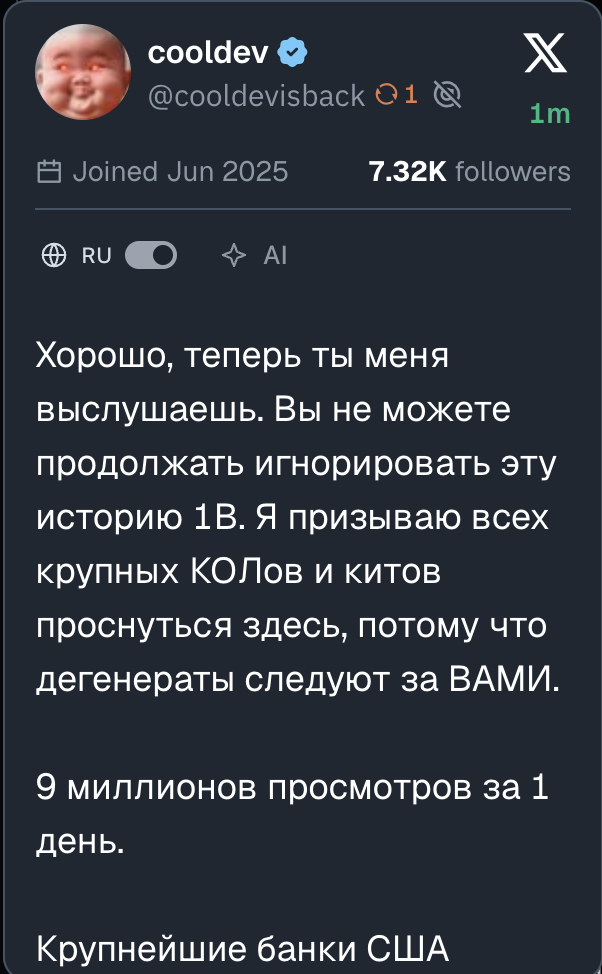

# Axiom Translator

**Версия 1.1.5 · Chrome · Axiom**

Переводит тексты Twitter-превью прямо в Axiom и по нажатию делает AI-разбор нарратива с вашим ключом OpenRouter.

## Возможности

- Перевод текста твита, цитат, community и описания аккаунта внутри выбранного превью.
- Сохранение разметки, отдельных стилей цитат и активных ссылок.
- Тумблер **RU** для переключения между оригиналом и переводом.
- Кнопка **AI** для анализа контекста выбранного токена и Twitter-данных.
- Кеш переводов и успешных AI-ответов.
- Локальные настройки ключа OpenRouter и пользовательского prompt.

## Пример перевода

## Настройки и использование

Нажмите значок расширения в Chrome, чтобы открыть настройки. Для перевода ключ OpenRouter не нужен. Для AI-разбора введите свой OpenRouter API key и сохраните настройки; запросы оплачиваются с вашего аккаунта OpenRouter.

В Twitter-превью переключатель с глобусом показывает оригинал/перевод. Нажатие **AI** собирает данные выбранного токена и показывает анализ; переключатель RU возвращает перевод.

## Установка

1. Скачайте ZIP репозитория через **Code → Download ZIP** и распакуйте его.
2. Откройте `chrome://extensions` и включите **Режим разработчика**.
3. Нажмите **Загрузить распакованное расширение** и выберите папку с `manifest.json`.
4. Обновите вкладку Axiom. Настройки открываются нажатием на значок расширения в Chrome.

Сборка и установка npm-зависимостей не требуются. После обновления файлов перезагрузите расширение на странице `chrome://extensions` и обновите Axiom.
